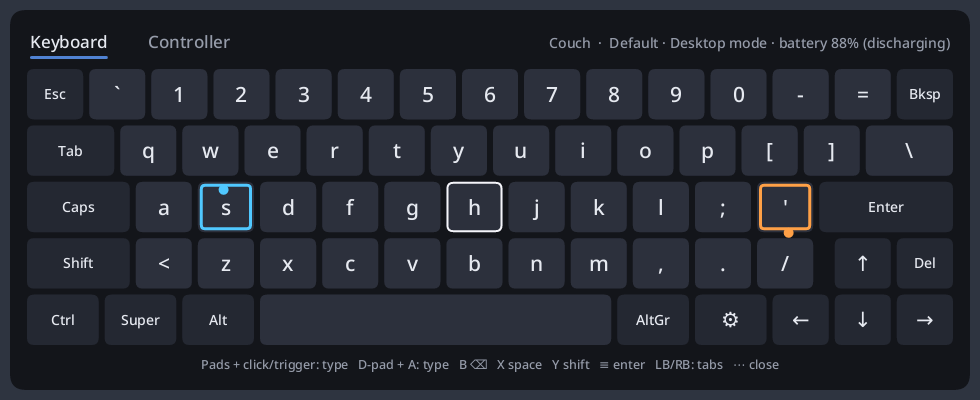

# puckd

Userspace driver for the 2nd-gen Steam Controller (2026) and its "Puck" dongle
(`28de:1304`), without Steam. It creates real input devices (uinput), so the controller
works as a gamepad in games and as mouse and keyboard on any Wayland desktop, including
native Wayland windows, which Steam's own desktop mode can't reach on some compositors.

> **Disclaimer:** this project was almost entirely "vibe coded": written by an AI coding
> assistant (Claude) in conversation with its author, who tested it on real hardware and
> steered the design. Treat it accordingly: it works well on the author's machine, it has
> tests for the tricky parts, but it hasn't had a careful human code review. Use at your
> own risk, and expect rough edges.

License: [GPL-2.0](LICENSE).



**[User manual](docs/manual.md)**: modes, buttons, the overlay, presets, button mapping,
haptics, troubleshooting.

## Features

- **Gamepad mode**: a virtual Xbox 360, Xbox Elite 2 (with paddles) or Steam Deck-layout
  pad per controller, with rumble. Chosen so SDL, gilrs/bevy, Wine/Proton and Steam all
  map the buttons the same way.
- **Desktop mode**: trackpad pointer (filtered, with acceleration; lifting your thumb or
  clicking doesn't move it; hold the click to drag), smooth scrolling on the left pad,
  configurable buttons and haptic ticks.
- **Hold Menu (≡)** to switch modes, with a click and a short banner.
- **Overlay (QAM ⋯)**: an on-screen keyboard that uses your keyboard layout, plus a
  settings menu: presets, button mapping (press the button to map it), input test,
  controller names, live settings.
- **Presets** per game, optionally switched automatically when an app gets focus.
- **Steps aside** while Steam (or an SDL3 game with native Steam Controller support) uses
  the controller, and takes over again afterwards.

## Requirements and compatibility

**System**
- Linux with `hidraw` and `uinput` (tested on kernel 7.2), and the Puck dongle `28de:1304`.
  A wired (`28de:1302`) or Bluetooth (`28de:1303`) controller should work but is untested.
- Read/write access to the Puck's hidraw nodes and `/dev/uinput` (the included udev rule).
- Rust (edition 2024) to build; fontconfig and a sans font for the overlay.

**Desktop**: gamepad and desktop modes only need uinput, so they work under any compositor
(even X11 or a text console). The overlay and per-app presets need these Wayland protocols:

| Feature | Wayland protocols |
|---|---|
| On-screen keyboard, settings, popups | `wl_compositor`, `wl_shm`, `wl_seat`, **`zwlr_layer_shell_v1`** |
| Key labels in your layout | `wl_keyboard` keymap (any compositor) |
| Per-app presets | **`zwlr_foreign_toplevel_manager_v1`** |

| Compositor | Overlay | Per-app presets |
|---|---|---|
| Hyprland | yes (tested) | yes (tested) |
| Sway, river, niri, other wlroots-style | yes (untested) | yes (untested) |
| KDE Plasma (KWin) | yes (untested) | no |
| GNOME (Mutter) | no (no layer-shell) | no |

## Installation

```sh
cargo build --release
```

Then install `target/release/puckd` into a directory in your `PATH`.

Permissions: puckd runs as your user. The udev rule gives the logged-in user access to the
Puck and to `/dev/uinput`:

```sh
sudo install -m644 dist/70-puckd.rules /etc/udev/rules.d/
sudo udevadm control --reload && sudo udevadm trigger
puckd list                    # every slot should say "rw ok" (replug the Puck if not)
```

Run exactly one puckd: it drives every controller and every dongle slot.

## Setup for

Starting puckd with your session, and turning off the desktop's pointer acceleration for
puckd's virtual mouse (puckd shapes the pointer itself):

- [KDE Plasma](docs/setup-kde.md)
- [Sway](docs/setup-sway.md)
- [Hyprland](docs/setup-hyprland.md)

### Alternative: systemd user service

Works with any compositor; restarts on failure, and `reload` re-reads the config:

```sh
install -Dm644 dist/puckd.service ~/.config/systemd/user/puckd.service   # adjust ExecStart if needed
systemctl --user daemon-reload
systemctl --user enable --now puckd
journalctl --user -u puckd -f
```

The service doesn't need `WAYLAND_DISPLAY`: without it, the overlay connects to the first
`wayland-*` socket in `$XDG_RUNTIME_DIR` and retries until the compositor is up. With
several Wayland sessions at once, run `dbus-update-activation-environment --systemd
WAYLAND_DISPLAY` from your compositor's startup.

## Configuration

Most settings can be changed live in the overlay (press QAM). For the rest, see
[`puckd.example.toml`](puckd.example.toml):

```sh
cp puckd.example.toml ~/.config/puckd.toml
puckd check-config
pkill -HUP puckd              # or: systemctl --user reload puckd
```

| Path | What |
|---|---|
| `~/.config/puckd.toml` | settings, the Default preset (`[gamepad]`), controller names (`[names]`) |
| `~/.config/puckd/presets/*.toml` | named presets |
| `~/.config/puckd/app-presets.toml` | which app uses which preset |
| `$XDG_RUNTIME_DIR/puckd/<slot>.json` | live status for bars (name, serial, mode, battery) |

## Usage

See the **[user manual](docs/manual.md)** for details and screenshots; the short version:

### Desktop mode (default buttons)

| Input | Action |
|---|---|
| right trackpad | pointer |
| right pad click, RT | left click; hold and move to drag / select text |
| LT | right click |
| left pad click, R3 | middle click |
| left trackpad, left stick | scroll |
| right stick | pointer |
| A / B / X / Y | Enter / Esc / Backspace / Space |
| d-pad | arrow keys |
| LB / RB | back / forward |
| View / L3 | Tab / Super |
| hold Menu (≡) | switch to gamepad mode |
| QAM (⋯) | overlay |

Everything is rebindable in `[desktop.buttons]` (key combos like `"ctrl+w"` work too).
Gyro mouse while a grip is touched: `desktop.gyro_mouse = true`.

### Gamepad profiles

| `gamepad.profile` | Looks like | Exposes |
|---|---|---|
| `xbox360` (default) | Xbox 360 pad `045e:028e` | standard Xbox layout, rumble; works everywhere |
| `xbox-elite` | Xbox One Elite 2 pad `045e:0b00` | plus the 4 back paddles |
| `extended` | Steam Deck controller (`hid-steam` layout, `28de:1205`) | plus paddles, QAM, trigger and pad clicks, analog trackpads, capacitive touches, motion device |

These identities are the ones SDL's and the community mapping database already know, so
SDL and gilrs agree on X/Y, triggers and paddles. With the Xbox profiles, the trackpads
still move the mouse in gamepad mode ("Trackpads as mouse", per preset, on by default).

### Overlay (QAM)

The overlay never takes keyboard focus (except while you type a name): keys go through
puckd's virtual keyboard into the focused window.

**Keyboard tab**: each trackpad moves a cursor over its half of the keyboard; a pad click or
LT/RT types the key under it. Or move the focus with the d-pad and press A. B / X / Y / ≡
are Backspace / Space / Shift / Enter. Modifiers are sticky (tap once for the next key,
twice to lock). LB/RB switch to the Controller tab.

**Controller tab**, in three sections:
- *Preset* (how games see the controller): the active preset, button mapping, emulated
  controller, motion device, rumble, trackpads as mouse in gamepad mode.
- *Settings* (shared by all presets): controller name, mode, pointer and scroll, gyro mouse,
  haptics, stepping aside. "Save settings" writes `puckd.toml`.
- *Tools*: input test, turn off controller.

Sub-pages (B goes back):
- **Presets**: "Default" is `puckd.toml`'s `[gamepad]` and never gets a button mapping.
  Changes show as "X (modified)"; save them to X or as a new preset (named with the
  keyboard, pre-filled from the focused app). Under *Apps*, tie the preset to the focused
  app. When that app gets focus, a popup asks: **A** always for this session, **X** once,
  **B** no. Leaving the app returns to the preset you last chose by hand.
- **Button mapping**: on an entry, **A** waits for the button it should act as (5 s), **X**
  opens a picker, **Y** resets it.
- **Input test**: everything the controller sends, live. LB + RB together go back.

Closing and reopening the overlay brings you back to the same page.

## Diagnostics and tools

```sh
puckd list                    # slots and permissions
puckd dump [SLOT]             # decoded input (--raw, --imu)
puckd -v                      # debug logging
puckd haptic-test             # play each rumble/haptic effect
puckd haptic-sides            # answer with LB/RB where each haptic side is felt
puckd mouse-study             # guided trackpad recording (stop the running puckd first)
puckd replay DIR              # replay a recording through the current pointer code
puckd pad-preview PROFILE     # create a virtual pad without a controller
puckd osk-preview [PAGE]      # show the overlay without a controller
puckd power-off [SLOT]        # turn a controller off
```

## Known limitations

- **Gyro isn't visible to SDL games**: SDL pairs the motion device with the pad through the
  evdev `uniq` string, which uinput can't set. A UHID-based (virtual DualSense) profile
  would fix it; see [PLAN.md](PLAN.md).
- `general.backoff = "any"` also steps aside for SDL3 games that drive the controller
  themselves (they then get the full controller). Use `"steam"` to step aside only for Steam.
- Not yet tested on kernel 7.3+, where the kernel's `hid-steam` handles this controller too.
