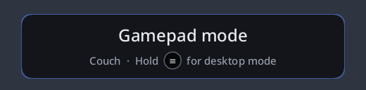
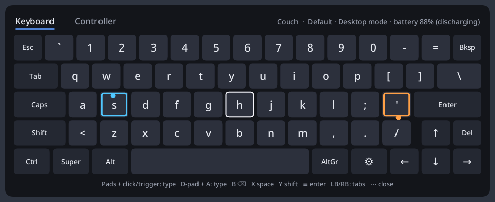
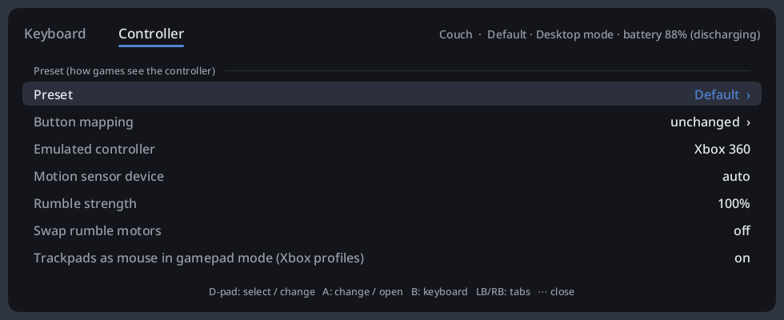
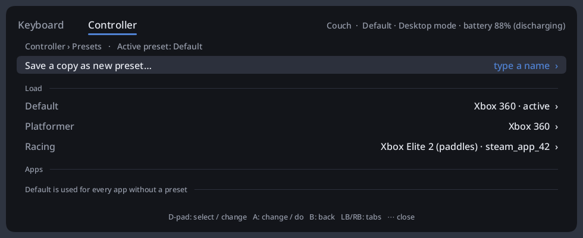
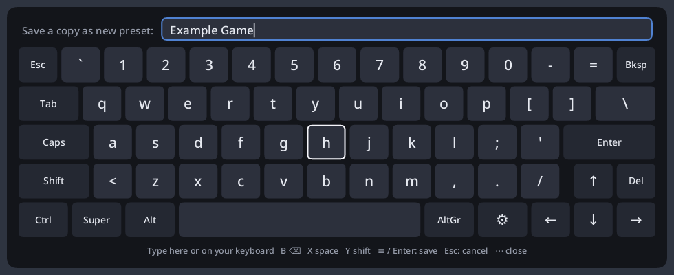
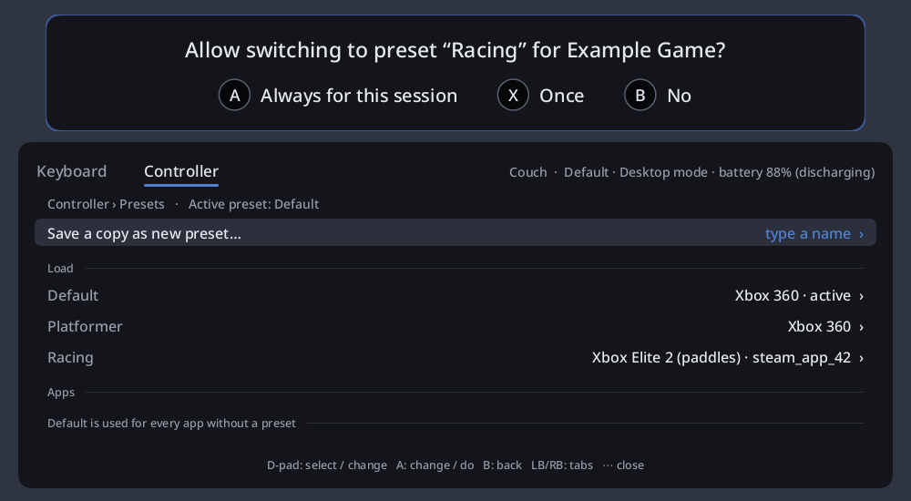
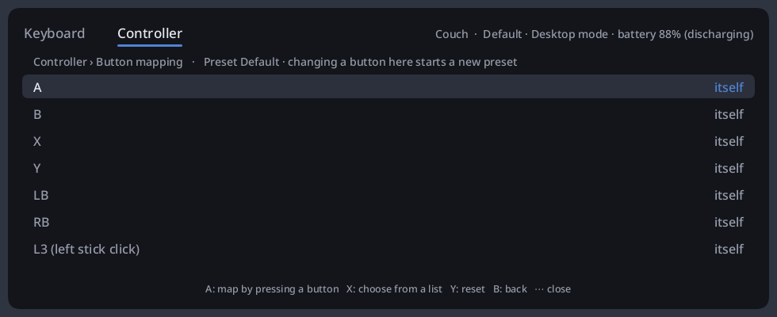
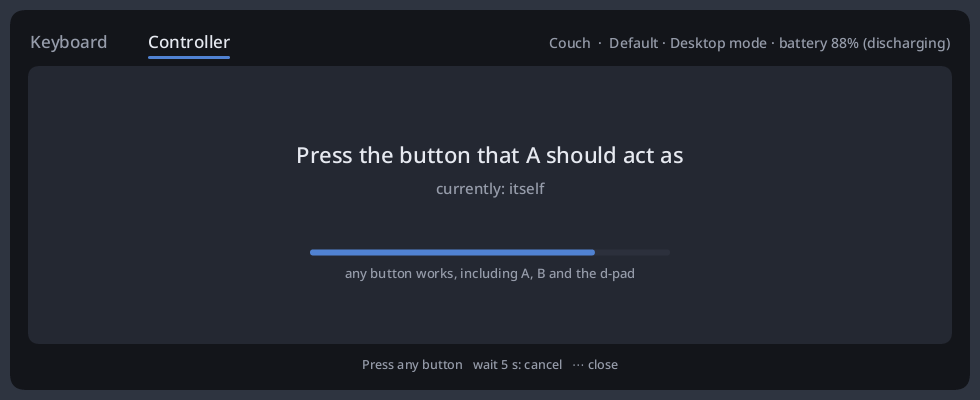
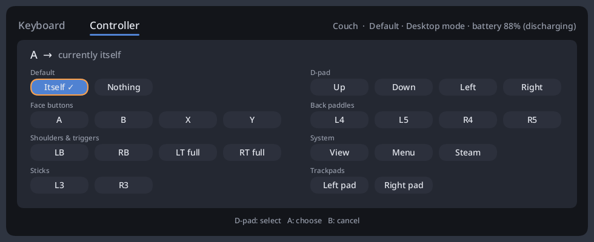
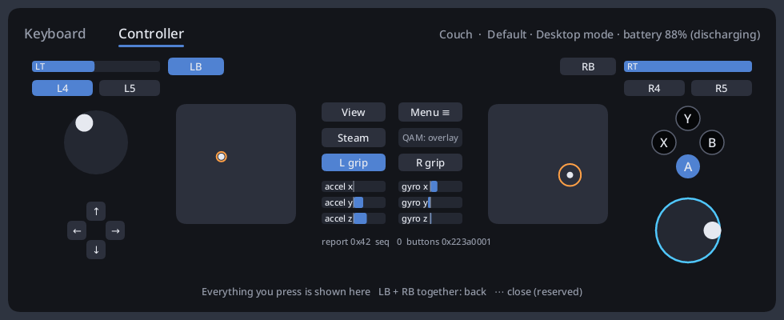

# puckd user manual

This manual covers everyday use. For installation see the [README](../README.md#installation)
and the setup page for your desktop.

- [Modes](#modes)
- [Desktop mode](#desktop-mode)
- [Gamepad mode](#gamepad-mode)
- [The overlay](#the-overlay)
  - [On-screen keyboard](#on-screen-keyboard)
  - [Controller settings](#controller-settings)
  - [Presets](#presets)
  - [Button mapping](#button-mapping)
  - [Input test](#input-test)
- [Haptics](#haptics)
- [Steam, Steam Input and games](#steam-steam-input-and-games)
  - [Basic install: puckd steps aside](#basic-install-puckd-steps-aside)
  - [Full install: Steam gets the real controller](#full-install-steam-gets-the-real-controller)
  - [Switching between Steam and puckd](#switching-between-steam-and-puckd)
  - [Games that support the Steam Controller](#games-that-support-the-steam-controller)
  - [Banners](#banners)
  - [Settings](#settings)
- [Troubleshooting](#troubleshooting)

## Modes

puckd has two modes, per controller:

- **Desktop mode** (default at start): the controller is a mouse and keyboard.
- **Gamepad mode**: the controller is a game controller (an Xbox pad by default).

**Hold the Menu button (≡, right of center) for about half a second** to switch. You feel a
click, and a short banner shows the new mode:

A short press of Menu still works as a normal button. The overlay's Controller tab also has
a *Mode* entry.

## Desktop mode

| Input | Action |
|---|---|
| right trackpad | move the pointer |
| right pad click, or RT | left click; hold it and move to drag or select text |
| LT | right click |
| left pad click, R3 | middle click |
| left trackpad (or left stick) | scroll; swipe faster to scroll faster |
| right stick | move the pointer |
| A / B / X / Y | Enter / Esc / Backspace / Space |
| d-pad | arrow keys |
| LB / RB | back / forward |
| View / L3 | Tab / Super |
| QAM (⋯) | open the overlay |

The trackpad pointer is filtered: a resting thumb doesn't drift, lifting your thumb doesn't
fling the pointer, and pressing down for a click doesn't move it. When you hold a pad click,
the drag starts once your thumb clearly moves.

If fast and slow movements feel unpredictable, check that your desktop's pointer
acceleration is off for the "puckd Mouse" device (see your desktop's setup page). Then tune
*Pointer speed* and *Pointer acceleration* in the overlay.

All buttons can be rebound in `~/.config/puckd.toml` under `[desktop.buttons]`; see
`puckd.example.toml`.

## Gamepad mode

Games see a regular game controller. The emulated controller is part of the
[preset](#presets):

| Emulated controller | Use it for |
|---|---|
| Xbox 360 (default) | everything; the most compatible |
| Xbox Elite 2 (paddles) | games that support the Elite's four back paddles (L4/L5/R4/R5) |
| Extended (Steam Deck layout) | games and tools that understand the Steam Deck's extra buttons and trackpads |

With the Xbox controllers, the trackpads still move the mouse and scroll in gamepad mode
(*Trackpads as mouse in gamepad mode*, on by default). Turn it off in a preset if a game
reacts badly to the moving cursor.

Rumble works in games through the normal force-feedback interface.

## The overlay

Press **QAM (⋯)** to open or close the overlay, in either mode. It sits at the bottom of
the screen and never takes keyboard focus: what you type goes to the window behind it.
While it is open, the controller only controls the overlay; games don't see that input.
Closing and reopening it brings you back to the same page and entry.

**LB / RB** switch between the *Keyboard* and *Controller* tabs. On the Controller pages,
the d-pad moves through entries, left/right or A changes a value, and **B** goes back.

### On-screen keyboard

- Each trackpad moves a cursor over its half of the keyboard (left: blue, right: orange).
  **Click the pad, or pull its trigger**, to type the key under the cursor.
- Or move the white focus with the d-pad or left stick and press **A**.
- **B** Backspace, **X** Space, **Y** Shift, **≡** Enter.
- Shift, Ctrl, Alt, Super and AltGr are sticky: tap once for the next key, twice to lock.
- The labels follow your keyboard layout (QWERTZ, accents and dead keys included).
- You can also click keys with a mouse.

### Controller settings

The header shows the controller's name, the active preset, the mode and the battery. The
tab has three sections:

- **Preset (how games see the controller)**: opens [Presets](#presets) and
  [Button mapping](#button-mapping); the emulated controller, motion sensor device, rumble
  strength and motor swap; trackpads as mouse in gamepad mode. These belong to the active
  preset.
- **Settings (shared by all presets)**: the controller's name, the mode, pointer speed,
  acceleration and inertia, scroll speed and direction, gyro mouse, haptics, when to
  step aside for Steam, and connect / disconnect banners. *Save settings* writes them to `~/.config/puckd.toml`; *Restore
  default settings* resets them (not the preset).
- **Tools**: [Input test](#input-test), and *Turn off controller*.

**Connect / disconnect banners**: when a controller connects or disconnects (turned off,
out of range, unplugged), puckd shows a short banner like the mode-switch one. Turning a
controller off with *Turn off controller* shows none, and neither does stepping aside for
Steam.

**Controller name**: puckd recognizes each controller by its serial number, so a name stays
with the controller whichever dongle slot it uses. Names are typed with the keyboard (see
below) and saved immediately.

### Presets

A preset is how the controller appears to games: the emulated controller, its button
mapping, rumble and the gamepad-mode trackpad option. Your personal settings (pointer
speed and so on) are not part of presets and stay the same when you switch.

- **Default** always exists. Its button mapping can't be changed; remapping a button while
  on Default starts a new, unsaved preset.
- After changing anything, the page shows *X (modified)*: **Save changes to X**,
  **Save as new preset…**, or **Discard changes**. Presets can also be renamed and deleted.
- **Load** switches to another preset. The list shows each preset's emulated controller and
  the apps it is linked to.

**Naming**: *Save as new preset…* and *Rename…* open a name field above the keyboard. Type
with the overlay keyboard or with your real keyboard; **Enter** or **≡** saves, **Esc**
cancels. The field starts with a suggestion from the window in focus (a Steam game's title,
otherwise the app's name).

**Per-app presets**: under *Apps*, *Use for <app> (focused)* links the active preset to the
app in focus (the window behind the overlay). Apps already linked are listed below it;
switching one off removes the link. When a linked app gets focus, puckd asks:

- **A, Always for this session**: switch now and every time you come back to that app,
  until puckd restarts.
- **X, Once**: switch now, ask again next time.
- **B, No**: keep the current settings and don't ask again this session.

The question disappears after 10 seconds. When you leave the app, puckd switches back to the
preset you last chose by hand (unless you changed something without saving). With no
controller connected (or while Steam has it), puckd neither asks nor switches; it does when
a controller connects while the app is still in focus. The behaviour
can be changed under *When an app with a preset gets focus*: ask, automatic or off.
Per-app presets need a compositor that reports the focused window (Sway, Hyprland, …;
not KDE).

### Button mapping

For games that get buttons wrong, each physical button can act as another one, or as nothing,
in gamepad mode. The mapping belongs to the active preset.

- **A** on an entry: press the button it should act as. Any button works, including A, B and
  the d-pad. After 5 seconds without a press it cancels.

  

- **X** on an entry: pick the target from a grid (the d-pad moves, A chooses, B cancels).

  

- **Y** on an entry: reset it to itself.

Changes apply immediately, so you can switch between the game and the overlay to try them.

### Input test

Shows everything the controller sends: buttons, sticks (with touch), triggers (with the
full-pull click), both trackpads (touch position, pressure, click), grips and motion
sensors. Every button is shown here instead of acting, so press **LB and RB together** to
go back. QAM always opens and closes the overlay, so it can't be tested here.

## Haptics

- A light tick while the pointer moves and per scroll step.
- A click when a trackpad clicks in, and a lighter tick when it releases, on the pad you
  used; also for mouse clicks with the triggers.
- A click on both pads when the mode switches.
- Ticks as the overlay's trackpad cursors move over keys, and clicks when typing.

Turn them off or down under *Haptics* in the Controller tab (or `[haptics]` in the config).

## Steam, Steam Input and games

Steam (through Steam Input) and some games know the Steam Controller and use all of it:
gyro, both trackpads, haptics, the Steam button. How puckd gets along with them depends on
how it is installed ([README](../README.md#installation)).

### Basic install: puckd steps aside

When Steam (or a game that supports the Steam Controller itself) starts using the
controller, puckd steps aside: its gamepad, mouse and keyboard go away, and the other
program has the controller to itself. A couple of seconds after it lets go, puckd is back.

While Steam has the controller, puckd's overlay and mode switch don't work, and Steam's own
desktop mode may not reach native Wayland windows on your desktop.

*Step aside for* in the Controller tab picks for whom: *any* program (default), only
*Steam*, or *never*.

### Full install: Steam gets the real controller

*Experimental.*

Steam sees a real Steam Controller: it lists it in its settings, and Steam Input features
(gyro, trackpads, haptics, its configurations) work in Steam and in games started from it.

When Steam starts, it takes the controller over and a banner says so:

> **Steam has the controller**
> Hold View + ≡ Menu for puckd

From then on Steam handles every button, including its Steam-button and long-press
features. puckd's gamepad, desktop mode and overlay rest: an open overlay closes (an
unfinished name or mapping is dropped), and a "switch preset?" popup goes away without
switching. When Steam quits, puckd takes the controller back by itself.

### Switching between Steam and puckd

**Hold View (⧉, left) and ≡ Menu (right) together for a second.**

- **While Steam has the controller**: puckd takes it back, and its modes, overlay and
  gamepad work again. For Steam the controller is unplugged until you hold the buttons
  again, or until you restart Steam.
- **While puckd has it**: Steam gets it back.

Steam and games never see these two buttons while you hold them together; a quick press of
just one of them still works as usual.

### Games that support the Steam Controller

A game that supports the Steam Controller itself (without Steam Input) doesn't take the
controller over; it shares it with puckd:

- **Gamepad mode**: the game gets the full controller (gyro, trackpads, haptics). QAM still
  opens puckd's overlay, and holding ≡ still switches modes; a short ≡ press reaches the
  game as usual.
- **Desktop mode, or with the overlay open**: the game sees the controller at rest.
- The game sees one controller, not two: puckd's own gamepad steps aside while the game
  uses the real one.

A short banner says when a game starts using the controller, and the overlay's header
shows which way games get the controller: "Gamepad mode, emulated" (puckd's gamepad) or
"Gamepad mode, native for *game*". If Steam starts meanwhile, Steam takes over. Games that
only know ordinary gamepads keep using puckd's gamepad.

### Banners

| Banner | When |
|---|---|
| *Steam has the controller* · Hold View + ≡ Menu for puckd | Steam took over |
| *puckd has the controller* · Until Steam restarts, or hold View + ≡ Menu | you took it back from Steam |
| *puckd has the controller* · Hold View + ≡ Menu to hand it to Steam | you kept it in puckd while Steam wasn't using it |
| *Steam and games may take it* · Hold View + ≡ Menu to keep it in puckd | you handed it back |
| *puckd has the controller* · Steam let go | Steam quit |
| *(game)* uses the controller · Native controller in gamepad mode | a game shares it |

### Settings

| Setting | Effect |
|---|---|
| *Steam and games may take over* (Controller tab, `passthrough`) | Full install only. Off: Steam and games never see the controller; they get puckd's gamepad like any other game. |
| `handover_buttons` (config file) | The buttons to switch between Steam and puckd, default `"view+menu"`, e.g. `"l4+r4"`. |
| *Step aside for* (Controller tab, `backoff`) | Basic install only (see above). |

## Troubleshooting

| Problem | Try |
|---|---|
| Nothing happens | `puckd list`: every slot should say "rw ok". If not, install Steam's udev rules (`steam-devices`) or puckd's rule, then replug the Puck. |
| Pointer speed feels inconsistent | Turn off your desktop's pointer acceleration for "puckd Mouse" (setup page for your desktop). |
| The overlay doesn't appear | Your compositor needs wlr-layer-shell (not available on GNOME). Run `puckd -v` and look for "overlay". |
| A game sees two controllers | Is Steam Input or another driver also active? puckd steps aside when Steam opens the controller. |
| Steam doesn't list the controller (full install) | Did you take it back with View + ≡ Menu? Hold the buttons again. Otherwise run `puckd -v`: it should say "pass-through device" when the controller connects. |
| The controller is connected over Bluetooth | Not supported: use the Puck or a cable. |
| Full install: `puckd list` says "permission denied" | Check the full install steps in the [README](../README.md#full-install-steam-gets-the-real-controller): the `puckd` group and `puckd-broker.socket`. |
| Buttons are mixed up in one game | Make a preset for it, try another emulated controller, or remap buttons. |
| Check what the controller sends | Overlay → Controller → Input test, or `puckd dump` in a terminal. |
